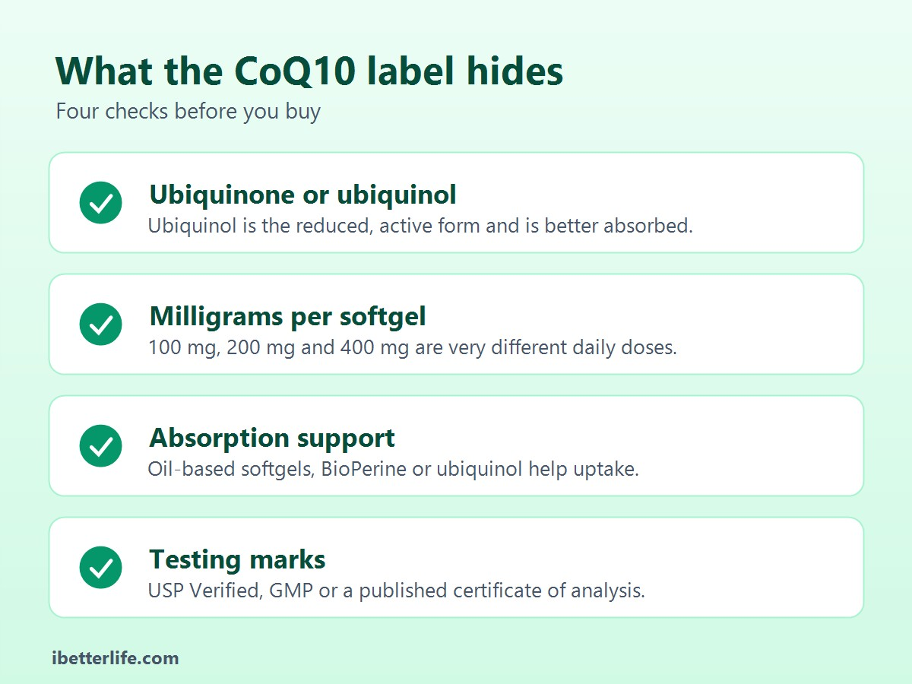
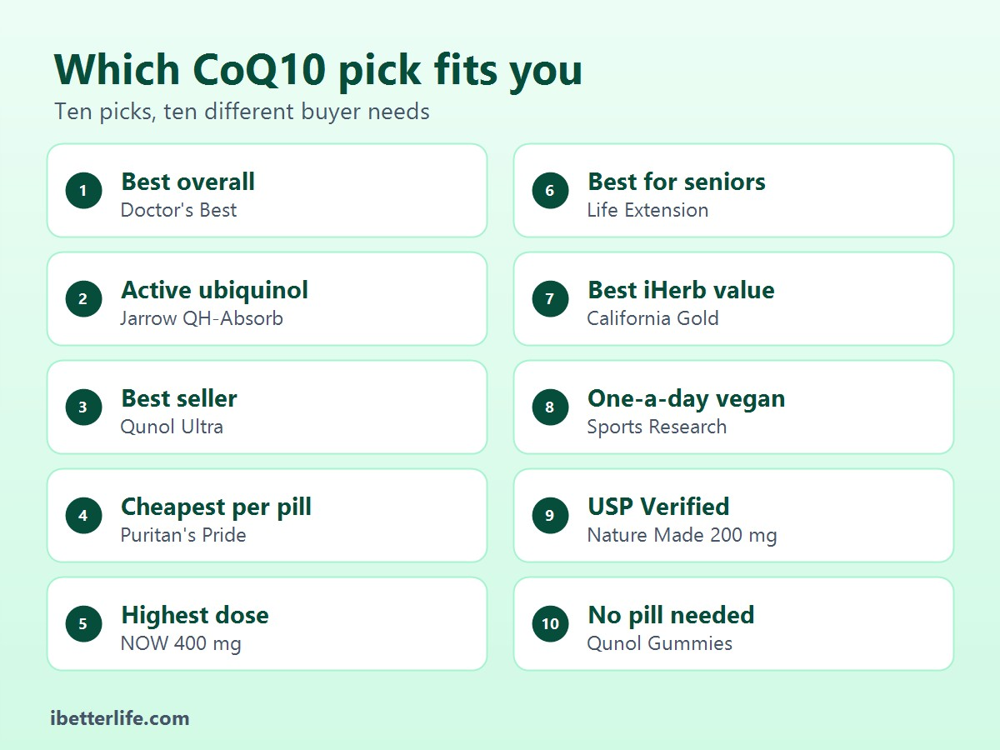

CoQ10 is one of those supplements where the bottle in front of you looks almost identical to
the one next to it, yet the labels describe very different things. Some say **ubiquinone**,
others say **ubiquinol**. Some put 100 mg in a softgel, others 400 mg. Some add black pepper
extract or a shot of oil to improve absorption, and some add nothing at all. If you are
shopping for a parent on a statin, for yourself after a cardiology appointment, or just for a
daily antioxidant, those differences decide whether you are getting your money's worth.

We compared ten genuinely popular CoQ10 products on Amazon and iHerb, read the supplement
facts panel on each one, and matched every bottle to the buyer it actually fits. Below you will
find one pick per buyer question, from the cheapest cost per 100 mg to the only gummy on the
list, plus the label checks that matter before you spend anything.

## Quick comparison

| Pick | Where to buy | CoQ10 per serving | Best for |
| --- | --- | --- | --- |
| Doctor's Best High Absorption CoQ10 | Amazon | 100 mg + BioPerine | Best overall |
| Jarrow QH-Absorb Ubiquinol | Amazon | 100 mg ubiquinol | Active ubiquinol form |
| Qunol Ultra CoQ10 | Amazon | 100 mg | Best seller |
| Puritan's Pride CoQ10 | Amazon | 100 mg (taken twice daily) | Cheapest per pill |
| NOW CoQ10 400 mg | Amazon | 400 mg | Highest dose |
| Life Extension Super Ubiquinol + PQQ | Amazon | 100 mg ubiquinol + PQQ | Best for older adults |
| California Gold Nutrition CoQ10 | iHerb | 100 mg | Best iHerb value |
| Sports Research CoQ10 with BioPerine | Amazon | 100 mg + BioPerine | One-a-day vegan softgel |
| Nature Made CoQ10 200 mg | Amazon | 200 mg | USP Verified label |
| Qunol CoQ10 Gummies | Amazon | 100 mg | No pill needed |

Prices and review counts in the cards below are approximate at the time of writing and change
often. Always check the current listing before buying.

## 1. Best overall: Doctor's Best High Absorption CoQ10 with BioPerine



This is the bottle we recommend first to most people because it solves the two problems that
matter at the same time: dose and absorption. Each vegan capsule delivers 100 mg of naturally
fermented CoQ10 along with BioPerine, a black pepper extract that is widely used to support
uptake of nutrients that are otherwise hard to absorb. One capsule a day is a realistic habit,
and the 120-count bottle covers four months.

The formula is also unusually clean for the price: non-GMO, vegan, soy free and gluten free. It
is not the highest dose in this guide and it is not ubiquinol, so it is the wrong pick if your
doctor has asked you to take 200 mg or more — but as a daily default for an adult who wants a
sensible 100 mg, it is hard to beat.

**Strengths**
- 100 mg naturally fermented CoQ10 plus BioPerine in one daily capsule
- Vegan, non-GMO, soy free and gluten free
- 120 capsules per bottle for roughly the price of a two-month supply elsewhere

**Specs:** 120 veggie capsules (120 servings) · 100 mg CoQ10 + BioPerine · ubiquinone form

[Check price on Amazon](https://www.amazon.com/dp/B0019GW38G?tag=ibetterlife-20)

## 2. Best ubiquinol: Jarrow Formulas QH-Absorb Ubiquinol 100 mg



Ubiquinol is the reduced, active form of CoQ10, and it is the form many people look for after
they stop feeling anything from ordinary ubiquinone. Jarrow's QH-Absorb is a well-known
softgel in this category: the brand reports that its proprietary ubiquinol formula raised
CoQ10 blood levels by about 222% at 100 mg per day, and by roughly 777% at 300 mg per day, in
clinical work.

The softgel format matters here, because ubiquinol is normally suspended in oil to stay stable
and absorbable. The trade-off is price: this is the most expensive bottle per serving in our
list, so it makes the most sense if a clinician has specifically suggested ubiquinol, or if you
have already tried ubiquinone without noticing a difference.

**Strengths**
- Active ubiquinol form, 100 mg per softgel
- Brand-published clinical results on blood-level increases
- Taken one to three times daily with a meal, so the dose is easy to adjust

**Specs:** 120 softgels (120 servings at one a day) · 100 mg ubiquinol · softgel in oil base

[Check price on Amazon](https://www.amazon.com/dp/B004VCOOUU?tag=ibetterlife-20)

## 3. Best seller: Qunol Ultra CoQ10 100 mg



Qunol is the brand most American shoppers meet first, and Ultra is its flagship ubiquinone
line. The formula is designed to be both water and fat soluble, and the company reports that
its clinical work shows about three times the absorption of regular CoQ10 powder — the "3X"
on the label is the brand's own comparison, not an independent ranking.

For a first bottle it is a low-friction choice: 100 mg per softgel, one a day, and a large
review base. If you want the shortest path from "I should probably take CoQ10" to a bottle in
your cabinet, this is it, even though it is not the cheapest or the strongest option here.

**Strengths**
- Water- and fat-soluble formula designed for better absorption
- One 100 mg softgel daily, 120 per bottle
- Very widely reviewed, so the failures are easy to find and judge

**Specs:** 120 softgels (120 servings) · 100 mg CoQ10 · ubiquinone, brand-claimed 3x absorption

[Check price on Amazon](https://www.amazon.com/dp/B0055OUOQQ?tag=ibetterlife-20)

## 4. Cheapest per pill: Puritan's Pride CoQ10 100 mg



If you take CoQ10 every day for years, cost per milligram starts to matter more than anything
on the front label. Puritan's Pride sells 240 rapid-release softgels in one bottle, which works
out to roughly **12 cents per 100 mg** — the lowest in this comparison, and far below the
premium ubiquinol bottles.

The catch is the dosing pattern: the label directs two softgels a day, so it is a two-pill
habit rather than a one-pill habit. There is also no absorption enhancer in the formula, which
is why the softgel format itself matters; oil-based softgels are generally absorbed better than
dry powder capsules.

**Strengths**
- Lowest cost per 100 mg of CoQ10 in this guide
- 240 softgels per bottle, so it lasts about four months
- Rapid-release softgel format with no proprietary blend games

**Specs:** 240 softgels (120 servings at two a day) · 100 mg per softgel · ubiquinone

[Check price on Amazon](https://www.amazon.com/dp/B004R61NCW?tag=ibetterlife-20)

## 5. Highest dose: NOW CoQ10 400 mg



Some clinicians recommend 200 to 400 mg a day, especially for older adults or people on
cholesterol-lowering medication. Taking that as four 100 mg pills is annoying; NOW puts the
whole 400 mg into a single softgel, which is the highest dose per pill on this list.

The formula is pharmaceutical grade and includes vitamin E and sunflower lecithin, both of
which are there to protect the oil and support absorption. NOW manufactures under NPA
A-rated GMP certification, and this bottle has one of the best rating profiles in our group. It
is a specialist pick, not a starter bottle: 400 mg is well above a typical maintenance dose.

**Strengths**
- 400 mg CoQ10 in one softgel, no pill stacking
- Pharmaceutical grade with vitamin E and sunflower lecithin
- NPA A-rated GMP certified manufacturing

**Specs:** 60 softgels (60 servings) · 400 mg per softgel · ubiquinone

[Check price on Amazon](https://www.amazon.com/dp/B0013OSM34?tag=ibetterlife-20)

## 6. Best for older adults: Life Extension Super Ubiquinol CoQ10 with PQQ



Life Extension builds this one for people who want the active form plus a little more support
in the same capsule. It pairs 100 mg of ubiquinol with PQQ and shilajit, two ingredients the
brand includes for cellular energy support, and it publishes a certificate of analysis for
every lot — which is the detail we care about most at this price.

CoQ10 absorption tends to decline with age, and ubiquinol is the form that skips a conversion
step in the body, so this is a sensible default for a parent or grandparent who does not want
to manage three different bottles. The bottle is small (30 softgels), so it is easy to trial
for a month before committing.

**Strengths**
- Active ubiquinol with PQQ and shilajit in a single softgel
- Certificate of analysis available for each lot
- Compact 30-count bottle, good for a one-month trial

**Specs:** 30 softgels (30 servings) · 100 mg ubiquinol + PQQ + shilajit

[Check price on Amazon](https://www.amazon.com/dp/B00DBYI6RQ?tag=ibetterlife-20)

## 7. Best iHerb value: California Gold Nutrition CoQ10 100 mg



iHerb's own California Gold Nutrition line is where a lot of shoppers land after comparing
prices, and this CoQ10 explains why: 120 veggie softgels, one a day, at a price that undercuts
almost every Amazon bottle in this guide once you count servings rather than softgels.

It is simple ubiquinone at 100 mg, in a vegetarian softgel, with the third-party testing and
non-GMO positioning the brand is known for. The listing carries tens of thousands of ratings,
which makes it one of the most reviewed CoQ10 products we looked at. If you already order from
iHerb and want one bottle that covers four months, start here.

**Strengths**
- 120 servings for under $20 at the time of writing
- Vegetarian softgel, non-GMO, third-party tested
- More than 41,000 iHerb ratings, so feedback is easy to gauge

**Specs:** 120 veggie softgels (120 servings) · 100 mg per softgel · ubiquinone

[Check price on iHerb](https://www.iherb.com/pr/california-gold-nutrition-coq10-100-mg-120-veggie-softgels/61074?rcode=RZK388)

## 8. Best one-a-day vegan softgel: Sports Research CoQ10 with BioPerine



Sports Research uses its Plantgel shell, which is free of carrageenan, fillers and animal
byproducts — the detail that matters most if you avoid gelatin but still want a softgel rather
than a dry capsule. Each Plantgel carries 100 mg of USP-grade CoQ10 with BioPerine, and the
label is a true one-a-day formula.

The brand manufactures in cGMP-compliant US facilities, and the bottle is 120 Plantgels, so it
stays competitive on cost despite the premium shell. The only reason it is not our top overall
pick is that the capsule is larger than Doctor's Best, which some people notice.

**Strengths**
- Vegan Plantgel shell with no carrageenan or animal byproducts
- 100 mg USP-grade CoQ10 plus BioPerine, one a day
- cGMP-compliant US manufacturing

**Specs:** 120 Plantgels (120 servings) · 100 mg CoQ10 + BioPerine · ubiquinone

[Check price on Amazon](https://www.amazon.com/dp/B07LC4VQTH?tag=ibetterlife-20)

## 9. Best USP Verified label: Nature Made CoQ10 200 mg



Most supplement bottles make claims; very few are checked by an outside body. Nature Made's
CoQ10 softgels carry the USP Verified mark, which means USP has tested the ingredients,
potency and manufacturing process of this specific product. For a shopper who does not want to
research a brand, that mark is the single most useful thing on the label.

At 200 mg per softgel it also fits the middle ground that a lot of people actually need:
stronger than a starter bottle, without jumping to 400 mg. One softgel daily with a meal, 105
per bottle. The formula itself is plain — no absorption enhancers — so pair it with a meal that
contains some fat.

**Strengths**
- USP Verified for ingredients, potency and manufacturing
- 200 mg per softgel, one a day
- Widely stocked, so restocking is easy

**Specs:** 105 softgels (105 servings) · 200 mg per softgel · ubiquinone

[Check price on Amazon](https://www.amazon.com/dp/B07CDXRBVJ?tag=ibetterlife-20)

## 10. Best no-pill option: Qunol CoQ10 Gummies



Some people simply will not swallow a softgel, and that is a real reason supplements get
abandoned. Qunol puts 100 mg of CoQ10 into an orange-flavored chewable gummy, so the daily
dose is one piece of candy rather than a capsule — and unlike most gummies, the dose is high
enough to be meaningful.

Two practical notes. First, gummies are heat sensitive: the listing itself warns that exposure
to heat or sunlight can melt or damage the product, so do not leave the bottle in a car or a
hot mailbox. Second, this is the least "clinical" product here; if you want ubiquinol or an
absorption enhancer, choose a softgel instead.

**Strengths**
- 100 mg CoQ10 per gummy, one a day
- Orange flavor, chewable, no water needed
- Good bridge for people who have stopped taking capsules

**Specs:** 120 gummies (120 servings) · 100 mg per gummy · ubiquinone in a gummy base

[Check price on Amazon](https://www.amazon.com/dp/B0914VSCJ1?tag=ibetterlife-20)

## How we picked

- **Form first** — we separated ubiquinone from ubiquinol instead of comparing them as if they
  were the same product, because absorption differs and price follows.
- **Dose per pill** — 100 mg, 200 mg and 400 mg answer different needs; we matched each bottle
  to a realistic daily routine rather than to the biggest number on the label.
- **Third-party checks** — USP Verified, GMP certification, or a published certificate of
  analysis counted in a product's favor.
- **Cost per 100 mg** — price divided by total milligrams in the bottle, so a cheap-looking
  60-count bottle does not beat a 240-count bottle by accident.

## FAQ

**Ubiquinone or ubiquinol — which should I buy?**
Ubiquinone is the standard, cheaper form and is what most research uses. Ubiquinol is the
reduced, active form and is generally better absorbed, but it costs noticeably more. If you are
new to CoQ10, start with a well-made ubiquinone like Doctor's Best and see how you feel; if a
clinician has recommended ubiquinol, or you have not noticed anything from ubiquinone, the
Jarrow or Life Extension options make sense.

**How much CoQ10 should I take each day?**
Common daily amounts in supplements range from 100 mg to 400 mg, and the right number depends
on why you are taking it. A typical maintenance bottle is 100 mg; higher doses are usually
suggested in a clinical context. Ask your doctor or pharmacist before going above 200 mg,
especially if you take prescription medication.

**Does CoQ10 interact with statins or blood thinners?**
CoQ10 is often taken by people on statins because statins can lower the body's own CoQ10
levels. It can also interact with warfarin and some other medications, which is why anyone on
prescription drugs should confirm the dose with their pharmacist before starting. Do not stop
or change a prescription on your own.

**Do I need to take it with food?**
CoQ10 is fat soluble, so taking it with a meal that contains some fat improves absorption. This
matters even more for plain ubiquinone capsules that have no oil base or absorption enhancer.

## A safety note

CoQ10 is generally well tolerated, with the most common complaints being mild stomach upset or
insomnia when taken late in the day. It is not a replacement for heart medication, blood
pressure treatment, or any prescription you have been given, and this article is information,
not medical advice. If you are pregnant, breastfeeding, managing a heart condition, or taking
blood thinners, talk to your doctor before adding a supplement — and check the label for the
exact amount of CoQ10 per serving, since that number, not the bottle size, is what you are
actually paying for.
