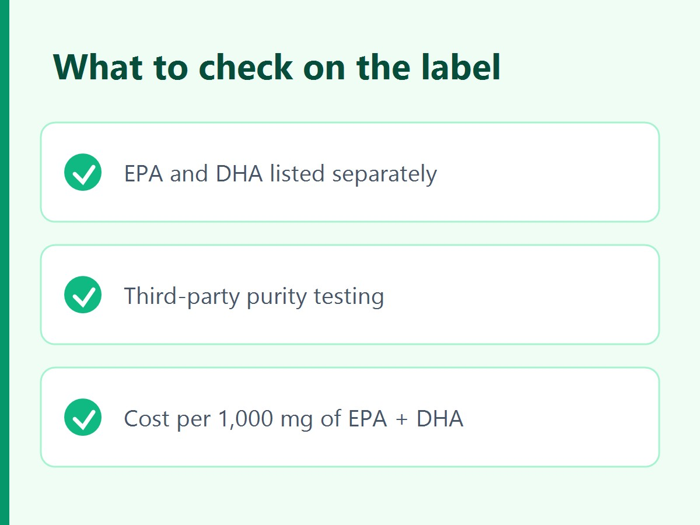

*This post contains affiliate links. If you buy through them, we may earn a commission at
no extra cost to you. See our [affiliate disclosure](/affiliate-disclosure/).*

Most fish oil labels lead with a big "1,200 mg" number that says nothing about the part you
actually want: **EPA and DHA**. We compared ten genuinely popular omega-3 products on Amazon
and iHerb, checked what each label really delivers per serving, and worked out who each bottle
is actually for — including kids, older adults, and people who hate big pills.

## Quick comparison

| Pick | Where to buy | EPA + DHA per serving | Best for |
| --- | --- | --- | --- |
| Nordic Naturals Ultimate Omega | Amazon | 1,100 mg (2 softgels) | Best overall |
| Sports Research Omega-3 | Amazon | 950 mg (1 softgel) | One pill a day |
| Nature Made Fish Oil | Amazon | 600 mg (2 softgels) | Cheapest pharmacy option |
| Kirkland Signature Fish Oil | Amazon | 600 mg (2 softgels) | Lowest cost per gram |
| California Gold Nutrition Omega-3 | iHerb | 600 mg (2 softgels) | Best iHerb value |
| Nordic Naturals Kids DHA | Amazon | 200 mg (4 minis) | Best for kids |
| NOW DHA-1000 | Amazon | 1,000 mg DHA (1 softgel) | Highest DHA |
| Life Extension Super Omega-3 | Amazon | 1,200 mg (2 softgels) | Best for seniors |
| Viva Naturals Triple Strength | Amazon | 2,070 mg (2 softgels) | No fishy aftertaste |
| Sports Research Omega-3 Minis | Amazon | 475 mg (1 mini) | Smallest softgel |

Prices and review counts below are approximate at the time of writing and change often. Check
the current listing before buying.

## How we picked

- **Dose transparency** — EPA and DHA listed separately, not hidden inside "fish oil concentrate"
- **Dose per pill** — how many softgels you need to reach 500 mg+ of combined EPA + DHA
- **Testing** — USP, IFOS, MSC, or clearly documented third-party testing
- **Fit for the buyer** — kids, seniors, and pill-averse shoppers need different formats
- **Cost per gram** — price divided by total EPA + DHA in the bottle

## 1. Best overall: Nordic Naturals Ultimate Omega



Nordic Naturals is the brand most often recommended by pharmacists, and Ultimate Omega is its
flagship. Two softgels deliver 1,280 mg of total omega-3, including 650 mg EPA and 450 mg DHA —
one of the highest verified doses in this group. It uses the triglyceride form, which is the
natural form found in fish, and the lemon coating keeps aftertaste down.

**Strengths**
- 1,100 mg combined EPA + DHA per two-softgel serving
- Triglyceride form and roughly 70% concentration
- Batch certificates of analysis available from the brand

**Specs:** 180 softgels (90 servings) · ~$59–65 · ~47,000 Amazon ratings

[Check price on Amazon](https://www.amazon.com/dp/B002CQU564?tag=ibetterlife-20)

## 2. Best for one pill a day: Sports Research Omega-3



If you hate swallowing handfuls of capsules, this is the one to look at. A single softgel
carries 690 mg EPA and 260 mg DHA — 950 mg combined, close to the 1,000 mg many people target
— so one pill replaces two or three from a standard bottle. It is made from wild Alaska pollock
and holds both IFOS 5-star and MSC certifications.

**Strengths**
- About 950 mg EPA + DHA in a single softgel
- IFOS 5-star purity rating and MSC sustainable sourcing
- Around 80% concentration, so very little filler oil

**Specs:** 180 softgels (180 servings) · ~$54 · ~60,000 Amazon ratings

[Check price on Amazon](https://www.amazon.com/dp/B01BTBZWBU?tag=ibetterlife-20)

## 3. Best budget pharmacy option: Nature Made Fish Oil



Nature Made is the bottle you see in every US drugstore, and it carries the USP Verified mark,
which means an independent organization checked the potency and purity. The trade-off is
concentration: two large softgels deliver about 600 mg of combined omega-3, so you take more
pills for the same dose.

**Strengths**
- USP Verified, one of the strictest third-party programs
- Widely available and often on sale under $20
- Simple 1,200 mg fish oil formula with no proprietary blends

**Specs:** 150 softgels (75 servings) · ~$18–21 · about 600 mg EPA + DHA per 2 softgels

[Check price on Amazon](https://www.amazon.com/dp/B010OV9N0W?tag=ibetterlife-20)

## 4. Lowest cost per gram: Kirkland Signature Fish Oil



Costco's Kirkland fish oil is the value pick for daily, long-term use. Each softgel provides
180 mg EPA and 120 mg DHA, and the 400-count bottle works out to roughly **$0.23 per gram of
combined EPA + DHA** — cheaper than any other product on this list. It is also USP Verified and
molecularly distilled.

**Strengths**
- Cheapest EPA + DHA per gram in this comparison
- 400 softgels per bottle, so it lasts months
- USP Verified and molecularly distilled

**Specs:** 400 softgels (200 servings) · ~$25–35 · 600 mg EPA + DHA per 2 softgels

[Check price on Amazon](https://www.amazon.com/dp/B002VLZHLS?tag=ibetterlife-20)

## 5. Best value on iHerb: California Gold Nutrition Omega-3



This is the number one ranked product in iHerb's omega-3 category, with close to half a million
ratings and a 4.8 average. Each capsule holds 1,100 mg of highly refined fish oil, and the
two-softgel serving delivers 360 mg EPA plus 240 mg DHA. The fish gelatin shell is free from
beef and pork, which matters if you avoid bovine or porcine ingredients.

**Strengths**
- #1 ranked omega-3 on iHerb with ~492,000 ratings
- Fish gelatin softgels, bovine-free and porcine-free
- Molecularly distilled, third-party tested, cGMP facility
- $12.20 for 100 softgels (50 servings)

**Specs:** 100 softgels (50 servings) · $12.20 · 600 mg EPA + DHA per 2 softgels

[Check price on iHerb](https://www.iherb.com/pr/california-gold-nutrition-omega-3-premium-fish-oil-100-fish-gelatin-softgels-1-100-mg-per-softgel/62118?rcode=RZK388)

## 6. Best for kids: Nordic Naturals Kids DHA Mini Chewables



Getting a child to swallow a fish oil capsule is a losing battle, so this pick is a small,
strawberry-flavored softgel that can be chewed or swallowed. It is made from 100% Arctic cod
liver oil in triglyceride form, with 80 mg EPA and 120 mg DHA per four-mini serving. Note the
serving size: you need four minis, so a 180-count bottle lasts about 45 days.

**Strengths**
- Chewable strawberry minis, no swallowing required
- 80 mg EPA + 120 mg DHA per 4 minis, from cod liver oil
- Non-GMO (Igen) and Friend of the Sea sustainable certification

**Specs:** 180 mini softgels (45 servings) · $24.61 · 4.5 from 4,500+ ratings

[Check price on Amazon](https://www.amazon.com/dp/B01N2XZTGL?tag=ibetterlife-20)

## 7. Highest DHA per capsule: NOW DHA-1000



DHA is the omega-3 most associated with brain and eye health, and most fish oils treat it as
an afterthought. NOW DHA-1000 puts a full 1,000 mg of DHA into a single softgel, which is
roughly double what a standard capsule provides. It is GMP certified, non-GMO, and soy-free.

**Strengths**
- 1,000 mg DHA in one softgel, with no EPA dilution
- GOED member with A-grade third-party GMP certification
- Non-GMO and soy-free formula

**Specs:** 90 softgels (90 servings) · $24.99 · 4.7 from 1,200+ ratings

[Check price on Amazon](https://www.amazon.com/dp/B081T378YX?tag=ibetterlife-20)

## 8. Best for seniors: Life Extension Super Omega-3



Life Extension designed this one for older adults: the softgels are deliberately smaller than
typical fish oil capsules, while two still deliver 700 mg EPA and 500 mg DHA. The formula adds
olive polyphenols and sesame lignans, and the fish oil is IFOS certified for purity. At 240
softgels per bottle, it is also one of the better values in the premium tier.

**Strengths**
- Smaller softgels that are easier to swallow
- 1,200 mg combined EPA + DHA per 2 softgels
- IFOS certified, with olive polyphenols and sesame lignans
- $23.59 for 240 softgels (120 servings)

**Specs:** 240 softgels (120 servings) · $23.59 · 4.5 from 5,900+ ratings

[Check price on Amazon](https://www.amazon.com/dp/B006P4B43W?tag=ibetterlife-20)

## 9. Best no-fishy-aftertaste: Viva Naturals Triple Strength



Fishy burps are the number one reason people stop taking fish oil. Viva Naturals uses the
re-esterified triglyceride (rTG) form, which is the most stable and best-absorbed form, and the
brand explicitly markets this bottle for no fishy burps or aftertaste. Each two-softgel serving
is genuinely strong: 1,500 mg EPA and 570 mg DHA.

**Strengths**
- rTG form with a documented no-fishy-burp claim
- 2,070 mg combined EPA + DHA per 2 softgels
- IFOS tested and pescatarian-friendly
- 4.7 average from more than 14,500 ratings

**Specs:** 180 softgels (90 servings) · $55.96 · 4.7 from 14,500+ ratings

[Check price on Amazon](https://www.amazon.com/dp/B014LDT0ZM?tag=ibetterlife-20)

## 10. Smallest softgel: Sports Research Omega-3 Minis



If even regular capsules feel too big, this is the mini version of our one-pill-a-day pick.
Each rice-grain-sized softgel still delivers 345 mg EPA and 130 mg DHA, and it keeps the same
MSC and IFOS 5-star certifications as the full-size bottle. The 10-step molecular distillation
and TOTOX limit under 5 are what keeps the oil fresh and odor-free.

**Strengths**
- Mini softgels sized for people who struggle with pills
- 475 mg combined EPA + DHA per mini softgel
- MSC certified and IFOS 5-star tested
- Same brand as our one-pill-a-day pick, in a different SKU

**Specs:** 120 mini softgels (120 servings) · $26.60 · 4.8 from 2,400+ ratings

[Check price on Amazon](https://www.amazon.com/dp/B0CHN9X9S2?tag=ibetterlife-20)

## Which one should you buy?

- **You want the safest all-round pick:** Nordic Naturals Ultimate Omega. The dose is high,
  the form is natural, and the brand publishes batch testing documents.
- **You want to swallow one pill a day:** Sports Research Omega-3. It is the only full-size
  pick here that clears 900 mg of EPA + DHA in a single softgel.
- **You are buying for a family on a budget:** Kirkland Signature. The 400-count bottle has
  the lowest cost per gram in this comparison, and it carries USP verification.
- **You are shopping for a child:** Nordic Naturals Kids DHA. Chewable strawberry minis beat
  any capsule for compliance, even though the serving is four minis.
- **You are shopping for a parent or grandparent:** Life Extension Super Omega-3. Smaller
  capsules and 1,200 mg per serving make it the easiest premium option to stick with.
- **You cannot stand fishy burps:** Viva Naturals Triple Strength. The rTG form and the
  brand's no-aftertaste claim address the most common complaint directly.

## What to watch out for

- **"1,000 mg fish oil" is not 1,000 mg omega-3.** Always read the supplement facts panel for
  EPA and DHA in milligrams.
- **Serving size tricks.** Some labels quote EPA + DHA for two, three, or even four softgels.
  The kids pick here needs four minis per serving.
- **Cheap does not always mean good value.** Compare cost per 1,000 mg of EPA + DHA, not cost
  per bottle.
- **Storage matters.** Fish oil oxidizes; keep it cool and dark, and do not use a bottle past
  its best-by date or if it smells strongly rancid.

## FAQ

### Is Amazon or iHerb cheaper for omega-3?

It varies by product and coupon. On this list, Kirkland Signature is the cheapest per gram of
EPA + DHA, while California Gold Nutrition is the cheapest way to try a well-reviewed bottle.
We re-check both stores whenever a product is updated.

### How much omega-3 do I actually need?

Most healthy adults aim for 250–500 mg of combined EPA + DHA per day. If you are pregnant, on
blood thinners, or managing a medical condition, talk to your doctor before supplementing.

### Are fish oil capsules safe for children?

Child formulations are dosed for kids, but you should still confirm with a pediatrician,
especially for children under 4 or those with allergies to fish. Never give an adult capsule
to a child as a substitute.

### Why do some fish oils cause fishy burps?

Oxidized oil and poor capsule coating are the usual culprits. Fresher oil (low TOTOX), the
rTG form, and enteric or smaller softgels tend to reduce aftertaste.

*These statements have not been evaluated by the Food and Drug Administration. This article is
not medical advice and is not intended to diagnose, treat, cure, or prevent any disease.*
